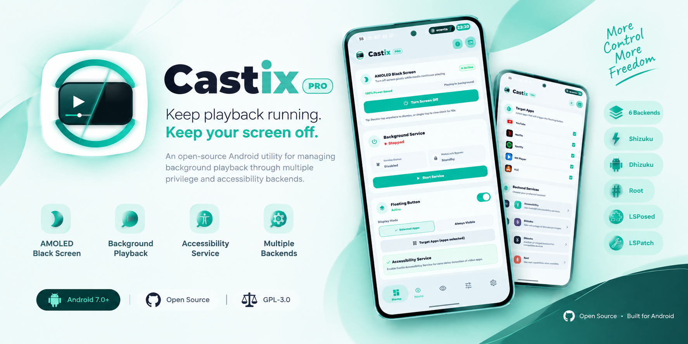
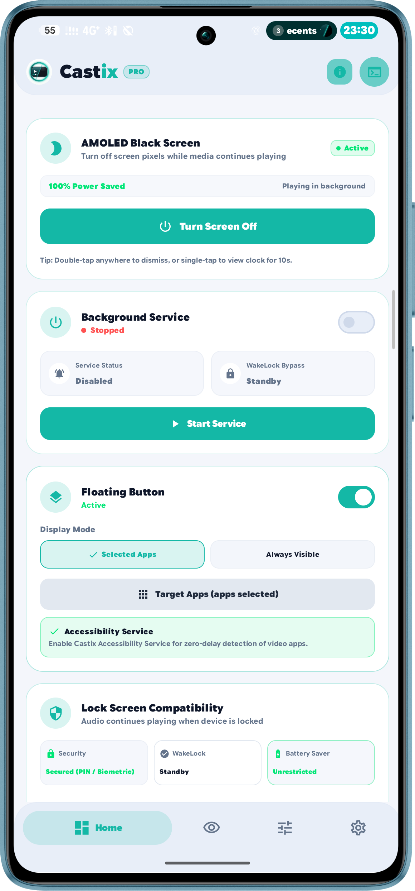
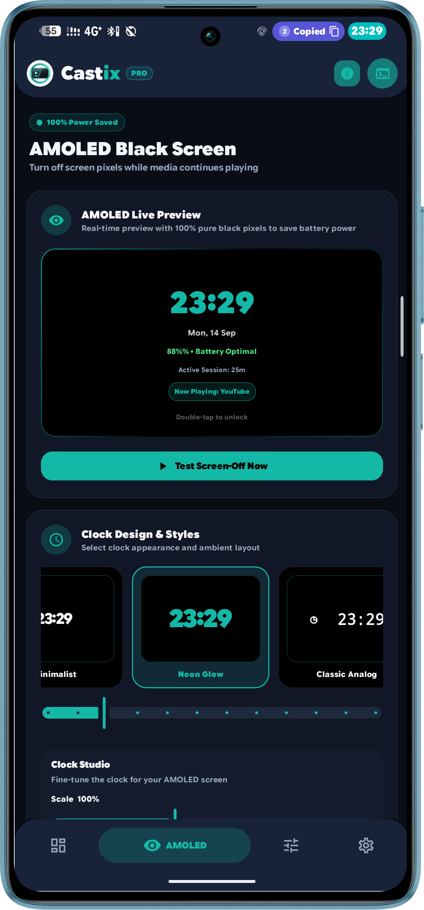
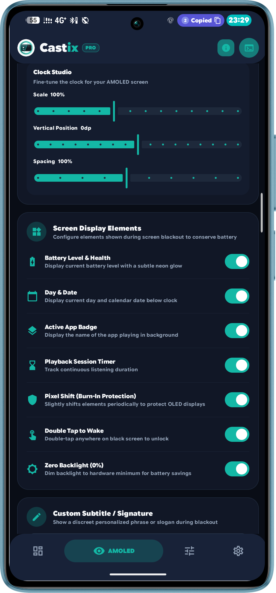
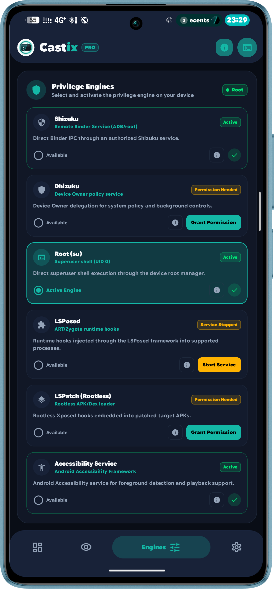
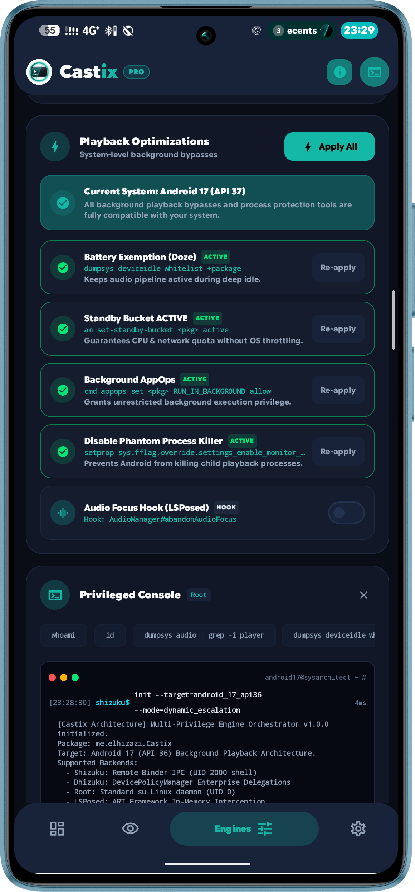
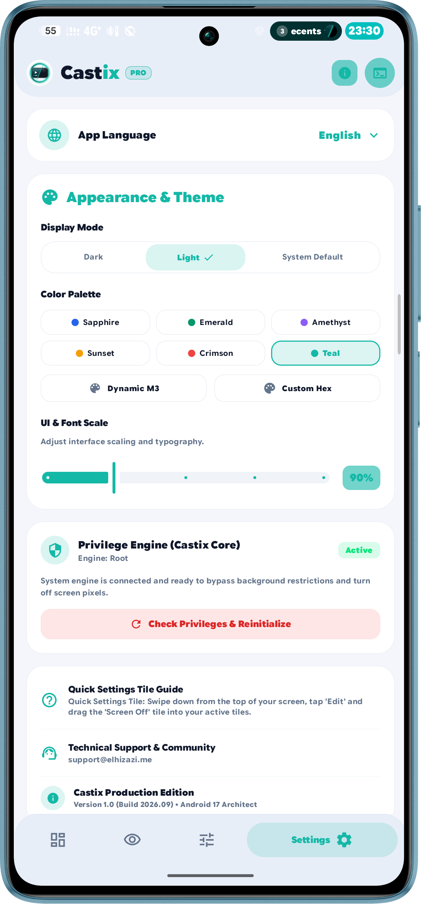

<div align="center">

<a href="https://castix.elhizazi.me/">
  
</a>

# Castix

**Keep playback running. Keep your screen off. Make darkness your own.**

An open-source Android utility for managing background playback and related playback restrictions through multiple privilege and accessibility backends, with customizable AMOLED black-screen experiences.

[](https://github.com/elhizazi1/Castix/releases/latest)

[](LICENSE)

[](https://github.com/elhizazi1/Castix/releases/latest)
[](https://castix.elhizazi.me/)
[](https://t.me/Castix_bot/castix)

[](https://github.com/elhizazi1/Castix/stargazers)
[](https://github.com/elhizazi1/Castix/releases)
[](https://github.com/elhizazi1/Castix/issues)

[Features](#-features) · [Screenshots](#-screenshots) · [Community](#-amoled-theme-community) · [Requirements](#-requirements) · [Building](#-building)

<a href="https://castix.elhizazi.me/">
  
</a>

</div>

---

## ✨ Features

| | Feature | Description |
|:--:|:--|:--|
| ▶️ | Background playback | Manage supported playback workflows and select target apps. |
| 🌑 | AMOLED mode | Black-screen mode with configurable clock styles, scale, vertical position and spacing. |
| 🎨 | Theme files | Import and share AMOLED designs using `.cas` files. |
| 🌐 | Theme community | Discover community designs from **More Themes** in AMOLED settings. |
| 📐 | Interface scale | Adjust the UI from 80% to 120%, with a 90% default, independently of the AMOLED clock. |
| ⚡ | Quick Settings | Access black-screen mode from Android Quick Settings. |
| 🛡️ | Backend management | Check backend status and permissions from the main interface. |
| 🌍 | Multilingual | 11 supported interface languages. |
| 🔓 | Independent build | No Firebase or Google Play Services dependency in the current build. |

## ⚙️ Multiple backends

     

Choose the backend appropriate for your device and workflow. Availability and behavior vary with Android version, configuration, installed services and permissions. Not all backends are required.

## 📱 Screenshots

<div align="center">






</div>

## 🎨 AMOLED theme community

Discover new AMOLED designs, download `.cas` themes, share your creations for review, follow releases and connect with other creators. Open **More Themes** in AMOLED settings to access the community services.

<div align="center">

[](https://t.me/Castix_bot/castix)
[](https://t.me/Castix_cas)
[](https://t.me/+tLUwyvvpOwxmZGY0)
[](https://castix.siwane.xyz/)

</div>

## 🚀 What's new in 1.2.0

- New **More Themes** menu in AMOLED settings.
- Direct access to the Telegram theme store, official channel and community.
- Adjustable interface scale with a 90% default and reset option.
- Improved interface scaling while preserving AMOLED clock customization.

[View releases and changelogs →](https://github.com/elhizazi1/Castix/releases)

## 🌍 Languages

Arabic · English · Chinese · Japanese · French · Spanish · Portuguese · German · Italian · Russian · Turkish

## 📋 Requirements

- Android 7.0 (API 24) or newer.
- Some features require an appropriate backend installed and configured on the device.
- Root, Shizuku, Dhizuku, LSPosed, LSPatch and Accessibility features are optional; Castix does not require all of them at the same time.

## 🛠 Building

### Android Studio

1. Clone or download the repository.
2. Open the project in Android Studio.
3. Allow Gradle to synchronize the project.
4. Build the desired variant from the Gradle/Build menu.

### Command line

```bash
./gradlew assembleDebug
./gradlew assembleRelease
```

The release configuration used for distribution may require the signing environment variables configured by the project maintainer. F-Droid builds should use their own signing process.

## 🤝 Support & documentation

[Report an issue](https://github.com/elhizazi1/Castix/issues) · [Usage guide](https://castix.elhizazi.me/usage.html) · [Privacy policy](https://castix.elhizazi.me/privacy.html) · [Contact](https://castix.elhizazi.me/contact.html) · [Security policy](SECURITY.md)

## 📦 Third-party components

Castix uses open-source Android libraries and the Shizuku API/provider. Their respective licenses remain applicable. See the project dependency declarations and upstream projects for individual license terms.

Castix includes minimal Xposed-compatible API stubs for interoperability with LSPosed and LSPatch. These stubs are not an embedded Xposed/LSPosed runtime. See [Third-party notices](THIRD_PARTY_NOTICES.md) for attribution and licensing context.

## ⚖️ License & disclaimer

Castix is licensed under the **GNU General Public License v3.0 or later**. See [LICENSE](LICENSE) for the complete license text.

Castix is provided without warranty. Availability and behavior of privilege backends depend on the Android version, device configuration, installed services and permissions granted by the user.

---

<div align="center">


**Castix · Open source · Built for Android**

Copyright © 2026 [Jamal El Hizazi](https://github.com/elhizazi1)

</div>
